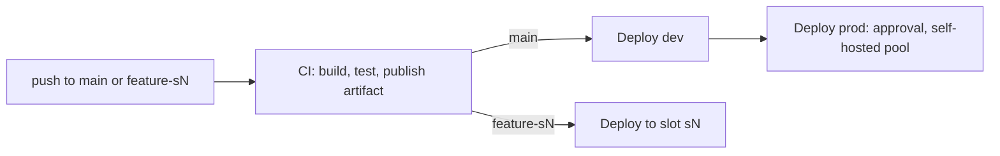

# Design

## Principles

1. **Build once, deploy many.** CI produces one versioned artifact. Release pipelines consume it through a `resources: pipelines` reference and never rebuild it, so what was tested is what ships.
2. **Thin pipelines, shared templates.** An application pipeline only supplies parameters (project path, app name, environment). Build and deploy logic lives in `templates/`.
3. **Configuration is layered.** `variables/common.yml` holds shared values; `variables/<env>.yml` holds per-environment values. Pipelines include the layers they need.
4. **Fail loudly.** Every deploy ends with a health check that fails the job if the target does not answer 200.
5. **Approvals live on environments**, not in pipeline logic. Attach checks to the Azure DevOps environment (`contoso-prod`).

## Flow

## Feature branches to deployment slots

Each feature branch gets an isolated pre-merge test environment in a deployment slot.

| Branch | Slot | URL |
| --- | --- | --- |
| `feature-s1` | `s1` | `https://<app>-s1.azurewebsites.net` |
| `feature-s2` | `s2` | `https://<app>-s2.azurewebsites.net` |
| ... | ... | ... |
| `feature-s7` | `s7` | `https://<app>-s7.azurewebsites.net` |

`feature-slot.yml` resolves the slot from the triggering branch name and fails if the branch does not match `feature-s1` to `feature-s7`. Slot count is a convention: create the slots you need and adjust the regular expression.

## Template reference

| Template | Purpose | Key parameters |
| --- | --- | --- |
| `jobs/build-dotnet.yml` | Restore, test, publish a .NET 8 app and publish the artifact | `projectPath`, `testProjects`, `artifactName` |
| `jobs/build-python.yml` | Install, test and package a Python app (App Service or Function App) | `workingDirectory`, `pythonVersion` |
| `jobs/deploy-appservice-zip.yml` | Deploy the artifact (run-from-package) to a site or slot, then verify health | `environment`, `appName`, `useSlot`, `slotName`, `pool` |
| `steps/verify-health.yml` | Retry a URL until it returns 200 or fail | `url`, `attempts`, `delaySeconds` |
| `variables/*.yml` | Layered configuration | none |

## Self-hosted agents

The prod stage selects a self-hosted pool and uses a demand (`TargetEnvironment -equals PROD`) so a job only lands on an agent that sits in the right network.

## Not in this repo

Infrastructure provisioning, secrets, and real service connection details. Service connection names here are placeholders and are literals on purpose: Azure DevOps resolves them when the run is queued.
